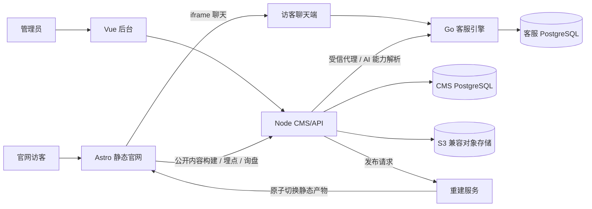

# ASTREVA 官网、后台与在线客服项目交接

> 交接基线：2026-10-22，本地仓库 `ASTREVA-main` 的代码与只读环境检查。本文给接手开发、测试及部署同事使用。功能状态以当前代码、数据库和实际环境为准；文中“已有实现”不等于生产环境已完成端到端验收。

## 1. 项目目标与当前关注点

这是一个三语官网及统一后台，集成媒体管理、AI 翻译与 SEO、在线客服、访客画像和静态发布。用户目前重点要求：

- 官网所有需要图片或视频的位置可从后台增删、上传或输入 URL、排序、切换媒体类型与播放方式；多个图片自动形成轮播。无配置时使用符合站点风格的默认素材，非视频媒体不显示播放视频入口。
- 中文、英文、阿拉伯语内容和 SEO 各自正确；中文内容变化后触发 AI SEO、译文与各语言 SEO，保存到数据库并发布，不因服务重启丢失。
- 官网正式域名可在后台填写并用于 canonical、hreflang、robots.txt 和 sitemap；实际 DNS、Caddy 与 HTTPS 仍由部署配置负责。
- 会话结束后出现满意 / 一般 / 不满意评价；一般与不满意需要填写建议；评价提交到真实 API，成功后收起官网客服浮窗。静默超时应自动关闭会话。
- 访客画像尽量展示可合法获取的地理、设备、路径、来源与访问数据，同时明确本地 IP 或缺少代理地理头时的限制。

## 2. 仓库结构与调用关系

| 路径 | 职责 |
| --- | --- |
| `frontend/` | Astro 静态官网，根路径中文，`/en/` 英文，`/ar/` 阿拉伯语。页面在 `src/pages/`，内容视图在 `src/views/`，模型在 `src/lib/types.ts`。 |
| `admin-web/` | Vue + Arco 统一后台，构建后由后台 API 同源托管在 `/site-admin/`。 |
| `admin-server/` | Node CMS/API、2FA、内容、媒体、翻译、SEO、埋点、客服代理及发布队列。入口 `server.mjs`。 |
| `servicebridge/backend/` | Go 客服引擎、REST/WebSocket、AI、策略、评价、画像及 PostgreSQL 持久化。 |
| `servicebridge/apps/user-web/` | 官网 iframe 内的访客聊天端与评价弹层。 |
| `servicebridge/apps/agent-mobile/` | Flutter 客服 App。 |
| `scripts/` | 本地启动、构建、发布及验证脚本。 |
| `deployments/ubuntu/` | Docker Compose、Caddy 和生产配置样例。 |



`admin-server/seed/site-content.json` 是首次初始化种子，**不是**线上运行内容。生产和当前本地运行内容在 PostgreSQL；媒体文件在 S3 兼容对象存储。不要靠修改种子文件来覆盖已初始化的网站。

## 3. 本地启动与快速定位

从仓库根目录执行：

```bash
npm install
cp .env.example .env                 # 仅首次；填写本地配置，不提交 .env
npm run build:admin-web              # 首次需要；启动脚本也会在产物缺失时构建
bash scripts/run-local-stack.sh
```

脚本先运行 `scripts/start-local-storage.sh`，启动 PostgreSQL 与本地 MinIO，再启动五个应用进程。它默认令客服引擎使用 `STORE_DRIVER=postgres`，并从 CMS 的 `DATABASE_URL` 推导独立的 `astreva_engine` 库；手动启动 Go 服务时必须核对实际 `DATABASE_URL`，避免写进 CMS 库。`DATA_ENCRYPTION_KEY` 会在缺失时生成并写入 `.env`；此密钥用于解密已保存的 AI Key，迁移和恢复时必须保留。不要把 `.env`、密钥或数据库密码写入交接记录或 Git。

| 服务 | 本地地址 | 主要日志 |
| --- | --- | --- |
| 官网 | `http://127.0.0.1:4321/` | `.local-logs/frontend-static.log` |
| 后台 / 登录 | `http://127.0.0.1:1337/site-admin/`、`/site-admin/login` | `.local-logs/admin.log` |
| 后台 HMR，可选 | `npm run dev:admin-web`，端口 `5174` | 启动终端 |
| 客服访客端 | `http://127.0.0.1:5173/?embed=1` | `.local-logs/servicebridge-user-web.log` |
| 客服健康检查 | `http://127.0.0.1:8080/healthz` | `.local-logs/servicebridge-backend.log` |
| 重建服务健康检查 | `http://127.0.0.1:8787/healthz` | `.local-logs/rebuild-webhook.log` |

本地必需的配置类别：CMS 数据库、客服数据库、S3/MinIO、后台 2FA 会话密钥、CMS/客服 AI Key 加密密钥、发布 webhook 密钥、官网/后台/客服公开地址与 CORS。变量名和示例见仓库根目录 `.env.example`；**不要复制示例密码进生产**。本地访问返回 200 只说明端点可达，不能代表后台登录、构建与客服业务全链路通过。

## 4. 内容、媒体与发布闭环

### 内容源和页面

后台「内容管理 → 官网内容」编辑中文源内容；页面类型包括首页、产品中心/分类/详情、解决方案、关于我们及子页、安装指南、FAQ、保修、支持、用户协议、隐私政策等。模型入口：`frontend/src/lib/types.ts`，对应渲染：`frontend/src/views/`。后台编辑表单：`admin-web/src/views/content/content-editor.vue`、`admin-web/src/components/content/SchemaForm.vue`。服务端内容入口：`admin-server/modules/content-router.mjs`、`admin-server/server.mjs`。

关键 API：

| 路由 | 用途 |
| --- | --- |
| `GET /site-admin-api/public-content?locale=zh-CN\|en\|ar` | 构建时读取内容；非中文译文未就绪或修订号不匹配返回 409。 |
| `GET /site-admin-api/bootstrap` | 已登录后台读取编辑内容和状态。 |
| `POST /site-admin-api/save` | 保存内容分区，增加中文修订号；按变化触发 SEO/翻译。 |
| `POST /site-admin-api/preview` | 构建草稿到 `/__preview/<随机 token>/`。 |
| `POST /site-admin-api/publish?source=current\|fallback` | 请求正式发布。 |
| `GET /site-admin-api/status`、`GET /site-admin-api/publish-jobs` | 读取构建状态和队列。 |

后台保存与发布是两步：保存更新数据库，发布由 `admin-server/modules/publish-service.mjs` 请求 `scripts/rebuild-webhook.mjs`；`scripts/build-frontend.mjs` 读取当前内容和真实译文、运行 Astro 构建，生产环境把产物写入发布卷的 `releases/`，再原子切换 `current` 符号链接。构建前会执行 `scripts/check-cms-content-contract.mjs`，用内容模型和种子验证必填字段。预览与正式发布目录分离。

### 媒体模型与默认素材

新媒体列表字段为 `mediaItems` 及场景专用的 `galleryMediaItems`、`videoMediaItems` 等。每项包含 `type`、`url`、可选 `alt`、`poster` 和 `playback`（`click` / `muted-autoplay`），最多 30 项。前台解析与旧字段兼容在 `frontend/src/lib/media.ts`；轮播、可视区播放、YouTube 嵌入/外跳在 `frontend/src/components/MediaCarousel.tsx` 与 `frontend/src/lib/video.ts`；后台列表编辑器在 `admin-web/src/components/content/MediaListField.vue`；保存时校验在 `admin-server/modules/content-media-validation.mjs`。默认素材及映射在 `frontend/public/assets/placeholders/`、`frontend/src/lib/default-images.ts`。

前端优先级：**有效的新列表 → 旧图片/视频字段 → 内置默认图**。明确配置空列表时会回退默认图。后台媒体库由 `admin-server/modules/media-router.mjs` 与 `media-store.mjs` 提供上传、预签名直传、替换、引用查询、删除及 AI 生图。删除媒体库文件前会检查内容引用；从页面列表移除媒体只移除引用，不能顺带删除原文件。`admin-web/src/views/content/media.vue` 是素材库入口。站内默认素材是代码资产，需随官网构建部署；后台上传素材在对象存储。

接手时要逐个页面核验所有图片、视频和点击播放入口是否都走新字段；尤其要核对产品详情、解决方案、弹出视频和移动端布局。代码已经有相关适配，**本次交接未重新执行后台逐位置保存→刷新→发布→浏览器播放的完整验收**。若出现“不是视频还显示播放视频”，先检查页面是否仍按旧 `videoUrl` / 标题 / 静态按钮判断，而不是按当前 `MediaCarousel` 项的 `type` 判断。

## 5. 多语言、AI SEO 与域名

- 中文 `zh-CN` 是源内容；英语 `en`、阿拉伯语 `ar` 译文保存于 PostgreSQL `site_content_translations`，与 `site_content.revision` 对齐。服务端翻译逻辑：`admin-server/modules/website-translation-service.mjs`。文本变化会排队；仅媒体变化可沿用旧译文并更新媒体字段。服务重启时 `admin-server/server.mjs` 会恢复未完成、失败或落后当前修订的翻译任务。译文仍需人工校对品牌、技术规格、法律条款和阿拉伯语排版。
- AI SEO 服务：`admin-server/modules/website-seo-service.mjs`；自动任务：`website-auto-seo.mjs`；API：`website-seo-router.mjs`；后台入口：`admin-web/src/views/ai/seo.vue`。中文可自动生成 SEO；英语和阿拉伯语在各自正文翻译完成后按本语言内容单独生成 SEO，成功后才标记 `ready`。自动任务状态保存于 `site_runtime_settings`，重启时恢复 `pending`。AI 供应商及 `translation` / `seo` 能力绑定通过后台配置，经客服引擎受信代理解析；不要把用户提供的 API Key 写进代码、文档或日志。
- 公开内容响应的 `meta.siteOrigin` 向构建传递后台设置的正式官网地址；`scripts/build-frontend.mjs` 用它产生三语 canonical、hreflang、robots.txt、sitemap。后台设置 API：`GET/PUT /site-admin-api/seo/site-domain`；持久化逻辑：`admin-server/modules/website-site-domain.mjs`。保存新域名会请求重建；如果排队失败，后台会返回原因，需要手动重新发布。
- **域名边界**：部署时的 `SITE_DOMAIN` 是 Caddy 站点与 HTTPS 证书入口，必须在生产 `.env.ubuntu` 里设置；后台「官网正式域名」控制 SEO 生成 URL，并存数据库。后台保存域名不会自动改 DNS、Caddy、证书或其它服务域名。更换域名要同时更新 DNS、部署环境、CORS、公开 URL，再发布并检查所有语言的 canonical/hreflang、robots 与 sitemap。构建拒绝 `example.com` 示例域名。

需要区分“任务持久化”与“输出已完成”：数据库中有 `ready` 译文时仍要打开三语页面检查正文、SEO 与链接；`website-auto-seo` 无状态行表示当前没有已记录的自动任务结果，不能据此宣称 AI SEO 的真实调用已验收。

## 6. 在线客服、评价、超时与访客画像

官网浮窗在 `frontend/src/components/ChatWidget.tsx`，访客端在 `servicebridge/apps/user-web/index.html`，客服 Go HTTP 路由在 `servicebridge/backend/internal/httpx/router.go`。后台由 `admin-server/modules/servicebridge-proxy.mjs` 代理引擎，并在 `admin-server/server.mjs` 中装配；浏览器侧不应接触引擎管理员凭证。客服 App 在 `servicebridge/apps/agent-mobile/`。

评价链路的现有代码：用户或客服结束会话后，访客端 `showEvalSheet()` 显示评价；满意（5 分）点击后立即提交；一般与不满意要求填写建议。提交 API 为 `POST /api/visitor/conversations/{id}/rating`，body 有 `score`、`tags`、`comment`，带访客 Bearer Token。成功后访客端向官网发 `servicebridge:conversation-closed` 消息，`ChatWidget.tsx` 收到后收起浮窗。客服端与后台通过评价查询 API 展示真实记录。**需要真实浏览器验证**：主动结束、客服结束、刷新恢复已结束会话、提交失败重试、重复提交以及满意/一般/不满意三条路径。

静默自动关闭在 `servicebridge/backend/internal/app/service_policy_sla.go` 的 `StartPolicyLoop` / `sweepAutoClose`，配置字段 `auto_close_idle_minutes`；默认巡检间隔 30 秒，可由 `SERVICE_POLICY_TICK_SECONDS` 调整。超时后调用正常关闭流程并写 `conversation.auto_closed` 审计；Go 单元测试在对应 `_test.go`。需要在本地或预发把阈值调小，观察实际会话、WebSocket 事件、评价弹层与后台审计。`0` 表示关闭自动结束功能。

访客访问埋点在 `admin-server/modules/analytics-router.mjs`，后台画像弹窗在 `admin-web/src/views/operations/components/VisitorProfilePopup.vue`，代理地理信息解析在 `admin-server/modules/request-geo.mjs`。画像会合并客服画像与官网访问记录，并从 User-Agent 推断设备、浏览器、系统。可信代理的地理头或可用 GeoIP 才可能提供地理数据；`127.0.0.1` 等本地地址无法推断真实国家。匿名访问按日生成匿名 ID，不能跨天识别同一访客；不要把“暂无数据”自动替换成猜测值。联调要同时检查 cookie 同意/未同意、访问路径、来源、设备头、CDN/代理头和 `visitor_ref` 关联。

## 7. 生产部署与数据保护

生产配置样例是 `deployments/ubuntu/.env.ubuntu.example`，实际配置保存在不入库的 `.env.ubuntu`。`SITE_DOMAIN`、`ADMIN_DOMAIN`、`SERVICE_DOMAIN` 分别供 Caddy 建立官网、后台和客服 HTTPS 入口；域名 DNS、证书、CORS、iframe 来源与公开 URL 必须一致。上线前填写 PostgreSQL、对象存储、2FA、AI Key 加密、客服代理、发布 webhook 等变量，并保留加密密钥和备份。对象存储的 `S3_ENDPOINT` 在预签名直传时还必须能被管理员浏览器访问。

```bash
cp deployments/ubuntu/.env.ubuntu.example deployments/ubuntu/.env.ubuntu
scripts/ubuntu-one-click.sh up
scripts/ubuntu-one-click.sh status
scripts/ubuntu-one-click.sh logs
```

上线由 `deployments/ubuntu/docker-compose.ubuntu.yml` 和 `Caddyfile` 负责。发布/回滚应以明确的 Git 版本和数据库、对象存储备份为基线；不要把本地未提交修改直接当成生产版本。数据库包含内容、译文、SEO 任务及运行设置；对象存储包含后台素材；两者要一起备份和恢复。详见[生产部署说明](../deployments/ubuntu/README.md)与[运营手册](OPERATIONS.md)。

## 8. 2026-10-22 本地快照与验证边界

本次只读检查：

| 项目 | 检查结果 |
| --- | --- |
| CMS 中文内容 | 修订号 `23`。 |
| 英文与阿拉伯语 | `en:ready:23`、`ar:ready:23`；各含 9 个静态页。 |
| `website-site-domain` 设置 | 未发现记录；目前还没有后台填写的正式官网域名。 |
| `website-auto-seo` 设置 | 未发现状态记录；需用后台触发一次真实 AI SEO 并验收。 |
| 本地端点 | `4321` 官网、`1337` 登录、`8787` 重建健康检查、`8080` 客服健康检查、`5173` 访客端均返回 HTTP 200。 |
| 默认媒体素材 | `frontend/public/assets/placeholders/` 下有 47 个文件。 |
| 工作区 | 当前在 `master`，存在大量用户已有的未提交修改与新增文件；接手者先看 `git status --short`，不要重置、覆盖或直接发布错误分支。 |

以上是一个时间点的读数，不保证进程持续运行。未在本次交接任务里重新执行完整测试、后台 2FA 登录后的媒体保存与发布、AI 上游真实生成、三语页面人工审查、客服评价或超时端到端验收。旧文档里如有“本地客服使用内存仓库”等说法，以当前 `scripts/run-local-stack.sh` 的 PostgreSQL 默认行为为准。

## 9. 接手顺序与验收清单

1. 先执行 `git status --short`，阅读本文件和相关文档，确定当前分支与未提交改动的归属；不要清理用户工作区。
2. 检查五个本地端点与 `.local-logs/`，确认 CMS 库、客服库和对象存储均可用；登录后台使用既有 2FA 流程。
3. 在后台选取首页、产品卡、产品详情、解决方案、关于我们、安装指南与视频弹层的代表性媒体位：新增图片、上传文件、填写视频/YouTube URL、切换类型、排序、删除，保存、刷新、预览、发布后再检查前台。核对纯图片时无播放按钮，视频点击/静音播放与 YouTube 外跳均正确。
4. 用一处中文正文变更触发 AI SEO 与翻译，核对 `site_content.revision`、两条译文 `source_revision/status`、自动任务状态、三语页面和各自 SEO；重启服务后重复查看，确保数据库结果仍在。上游失败时核对报错、重试和语言 `409` 处理。
5. 正式域名确定后先完成 DNS/Caddy/HTTPS，再在后台填写域名，检查重建队列和三语 canonical/hreflang、`robots.txt`、`sitemap-index.xml`；当前没有正式域名，不要用 `example.com` 作为发布目标。
6. 用浏览器实际走完整客服会话：访客/客服结束、三档评价、建议必填、评价 API 记录、浮窗收起；缩短超时阈值验证自动关闭与审计。再检查画像各字段来源，不把本地 IP 地理缺失当作代码错误。
7. 运行针对改动的单元测试及必要构建；常用命令：`npm run check`、`npm run test:admin`、`npm run build:admin-web`、`cd servicebridge/backend && go test ./...`、`npm run verify`。生产部署前按部署清单另行执行备份恢复、真机推送和 HTTPS 验收。

## 10. 相关文档与排障入口

- [根 README](../README.md)：项目目录与基本命令。
- [官网内容闭环](CMS_CLOSED_LOOP.md)：保存、预览、发布和降级版本。
- [媒体改造任务说明](media-system-task-prompt.md)：媒体字段、行为与验收要求；部分是目标说明，实际状态仍要看代码。
- [功能状态总表](FEATURE_STATUS.md)：历史功能盘点；可能滞后于当前未提交改动。
- [AI 翻译与画像设计](AI_TRANSLATION_AND_PROFILE.md)：数据与流程背景。
- [生产部署说明](../deployments/ubuntu/README.md)：Compose、Caddy 和域名。
- [生产检查清单](PRODUCTION_CHECKLIST.md)：CORS、数据库指向与上线注意事项。
- [运营手册](OPERATIONS.md)：数据库、监控、备份和恢复。
- [客服系统说明](../servicebridge/README.md) 与 [API 协议](../servicebridge/docs/API与WebSocket协议.md)：会话、评价与 WebSocket 事件。

排障时按数据流找：后台界面 → `admin-server` API → PostgreSQL / 对象存储 → 重建日志 → 生成的静态页面；客服问题再追访客端请求、Go API、WebSocket 与后台代理。不要仅凭页面提示文字判断接口已经成功。
